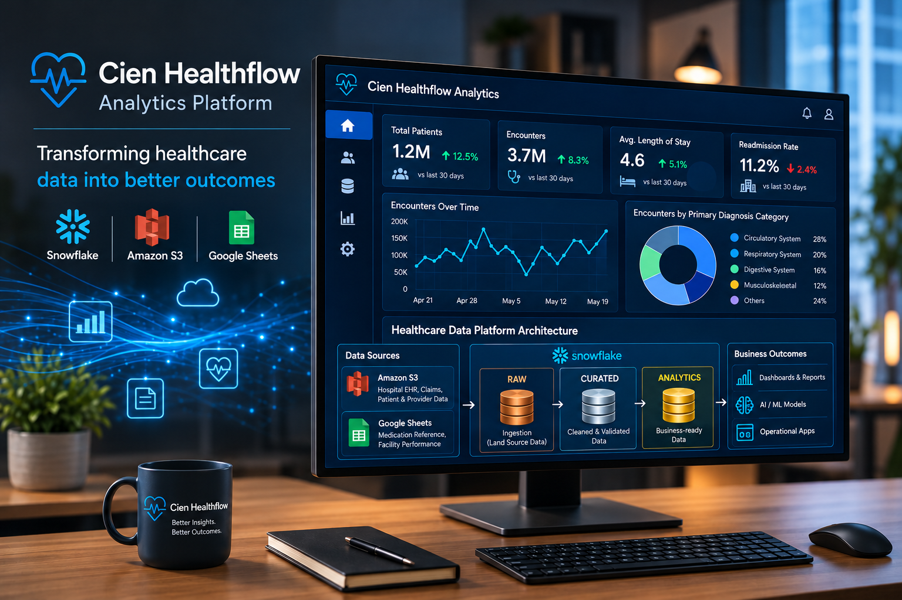
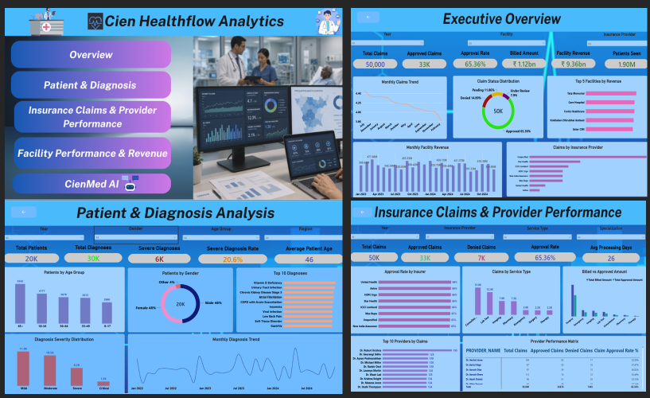
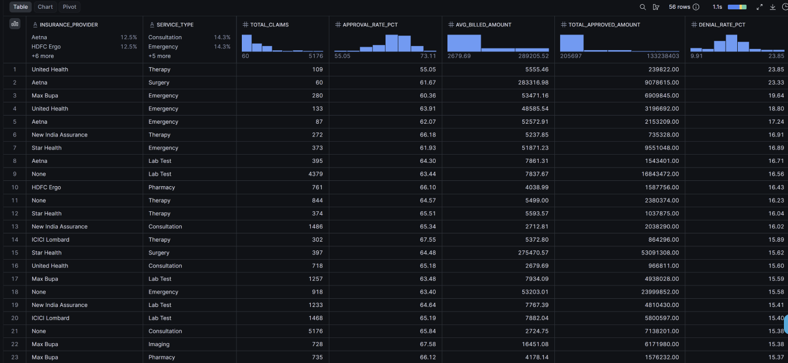
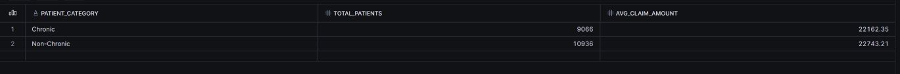
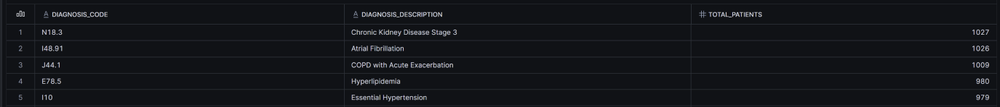
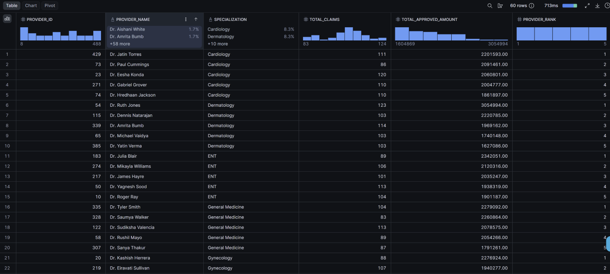
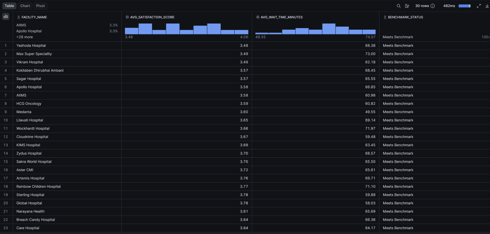
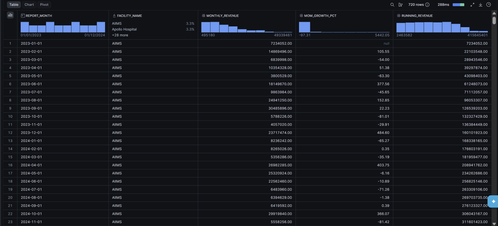

# Cien-Healthflow-Analytics

An end-to-end healthcare intelligence platform designed to unify fragmented patient, insurance claims, and operational data into a secure, reliable, and intelligent data ecosystem. The platform streamlines data processing, ensures data quality and governance, automates workflows, and transforms complex healthcare information into actionable insights. It also aims to integrate an AI-powered medical knowledge assistant to deliver context-aware, evidence-grounded responses, supporting smarter decision-making, operational efficiency, and improved healthcare outcomes.



## 1. Business Problem

Healthcare organisations generate large volumes of patient records, insurance claims, diagnosis histories, and operational metrics across disconnected systems.

This fragmented data creates several challenges:

- **Data Silos:** Patient, claims, and facility information is stored across different platforms.
- **Data Inconsistency:** Multiple data sources make validation and standardisation difficult.
- **Manual Processing:** Repeated ingestion and transformation tasks reduce operational efficiency.
- **Limited Visibility:** Healthcare teams struggle to analyse claim costs, patient trends, and facility performance.
- **Security & Governance:** Sensitive healthcare information requires controlled access and reliable data management.

## 2. Project Objectives

Build a scalable healthcare data platform using Snowflake to:

- Centralise structured healthcare data from Amazon S3 and Google Sheets.
- Implement a **Medallion Architecture (RAW → CURATED → ANALYTICS)**.
- Develop reliable ingestion, validation, and transformation pipelines.
- Automate data processing using Snowflake Streams and Tasks.
- Apply data security, governance, and role-based access controls.
- Enable analytical reporting on patient demographics, claims, diagnoses, and facility performance.
- Extend the platform with an AI-powered medical knowledge assistant.

## 3. Technology Stack

| Technology                | Purpose                                       |
| ------------------------- | --------------------------------------------- |
| Snowflake                 | Cloud data platform and data warehousing      |
| SQL                       | Data ingestion, transformation, and analytics |
| Python                    | Data integration and ingestion automation     |
| Amazon S3                 | Cloud storage for healthcare CSV datasets     |
| Google Sheets             | Reference and operational metrics sources     |
| Snowflake Stages          | External and internal data ingestion          |
| Snowflake Streams & Tasks | Change data capture and workflow automation   |
| Snowflake RBAC            | Data security and access governance           |

## 4. Data Sources

The platform integrates six healthcare datasets from two source systems.

**Source 1: Amazon S3 — Healthcare Records**

| Dataset                   | Records | Description                                                    |
| ------------------------- | ------: | -------------------------------------------------------------- |
| `patients.csv`          |  20,000 | Patient demographics, insurance, and contact details           |
| `providers.csv`         |     500 | Healthcare providers, specialisations, and facility mappings   |
| `claims.csv`            |  50,000 | Insurance claims, billing, approvals, and denials              |
| `diagnoses_history.csv` |  30,000 | Patient diagnosis history, severity, and treatment information |

**Source 2: Google Sheets — Reference & Operational Data**

| Dataset                          | Records | Description                                                          |
| -------------------------------- | ------: | -------------------------------------------------------------------- |
| `medications_reference.csv`    |     200 | Medication catalogue, pricing, and classifications                   |
| `facility_monthly_metrics.csv` |     720 | Facility-level patient volume, satisfaction, revenue, and wait times |

**Total source records: 101,420**

## 5. Data Architecture

The platform follows a three-layer Medallion Architecture.

```text
           DATA SOURCES
                 |
      +----------+----------+
      |                     |
  Amazon S3            Google Sheets
  (4 CSV Files)         (2 Datasets)
      |                     |
      +----------+----------+
                 |
                 v
         SNOWFLAKE PLATFORM
                 |
          RAW (Bronze)
        Data Ingestion
                 |
                 v
        CURATED (Silver)
     Cleaning & Validation
                 |
                 v
       ANALYTICS (Gold)
     Data Models & Insights
                 |
                 v
      Business Intelligence
       & AI Integration
```

### Snowflake Database Structure

```text
HEALTHFLOW_DB
│
├── RAW
│   └── Source Data & Landing Tables
│
├── CURATED
│   └── Cleaned & Validated Data
│
├── ANALYTICS
│   └── Analytical Tables & Views
│
└── GOVERNANCE
    └── Security Policies & Access Controls
```

### Virtual Warehouse Configuration

| Warehouse       | Size   | Auto-Suspend | Purpose                 |
| --------------- | ------ | ------------ | ----------------------- |
| HF_INGEST_WH    | SMALL  | 60 sec       | Source data ingestion   |
| HF_TRANSFORM_WH | MEDIUM | 120 sec      | Data transformations    |
| HF_ANALYTICS_WH | MEDIUM | 300 sec      | Analytics and reporting |
| HF_DEV_WH       | XSMALL | 60 sec       | Development and testing |

## 6. Implementation Progress

### Phase 01 — Snowflake Environment Setup

**Objective:** Establish the Snowflake infrastructure and database environment.

Key activities:

- Configured the `HEALTHFLOW_DB` database.
- Established four schemas: `RAW`, `CURATED`, `ANALYTICS`, and `GOVERNANCE`.
- Set up dedicated virtual warehouses for ingestion, transformation, analytics, and development.
- Configured warehouse sizing and auto-suspend settings.
- Established the foundational Snowflake object hierarchy.

**Outcome:** Snowflake environment structured to support data ingestion, processing, analytics, and governance.

### Phase 02 — Amazon S3 Data Ingestion

**Objective:** Load structured healthcare datasets from Amazon S3 into Snowflake.

Key activities:

- Configured CSV file formats with appropriate parsing settings.
- Established an external Snowflake stage for Amazon S3.
- Created RAW tables for patients, providers, claims, and diagnosis history.
- Used Snowflake `COPY INTO` to perform bulk data ingestion.
- Incorporated load validation and source-to-target record-count checks.

**Outcome:** Four healthcare datasets ingested into Snowflake's RAW layer, establishing the foundation for downstream transformations.

### Phase 03 — Google Sheets Data Ingestion with Python

**Objective:** Integrate reference and facility-level operational datasets into Snowflake.

Key activities:

- Established a Python-based ingestion approach for Google Sheets data.
- Used `gspread` and `snowflake-connector-python` as the integration tools.
- Prepared the ingestion workflow for medication reference and facility monthly metrics datasets.
- Loaded both datasets into the Snowflake RAW layer.
- Included data-loading validation and error-handling requirements.

**Outcome:** Expanded the RAW layer to six source datasets, bringing patient, claims, provider, diagnosis, medication, and facility information into a centralised healthcare data platform.

### Phase 04 — Data Transformation (RAW → CURATED)

**Objective:** Transform raw healthcare data into clean, validated, and standardised datasets using Snowflake SQL.

**Key Activities:**

- Created Snowflake Streams on RAW tables to track data changes (CDC).
- Implemented `MERGE` operations to handle inserts, updates, and deletes.
- Applied data deduplication using `QUALIFY` and `ROW_NUMBER()`.
- Standardised data types, handled NULL values, and validated critical fields.
- Added derived attributes such as patient age, claim processing days, and high-value claim flags.
- Created a consolidated `claim_line_items` table by joining claims with diagnosis history.
- Performed data quality checks and record-count validation.

**Outcome:** Established a structured CURATED layer with cleaned, deduplicated, and standardised healthcare datasets, ready for automated processing and downstream analytics.

### Phase 05 — Task Scheduling & Automation

**Objective:** Automate incremental data processing from RAW to CURATED using Snowflake Streams and Tasks.

**Key Activities:**

- Created Snowflake Tasks to execute `MERGE` operations for incremental data processing.
- Integrated Streams with Tasks to capture and process data changes (CDC).
- Configured a Task DAG using `AFTER` dependencies to manage execution order.
- Scheduled the root task to run automatically every 10 minutes.
- Enabled tasks and monitored execution using Snowflake Task History.
- Validated the automation pipeline by testing new data inserts and updates.

**Outcome:** Established an automated, dependency-driven ELT pipeline that incrementally synchronises RAW and CURATED datasets, reducing manual processing and supporting continuous data updates.

### Phase 06 — Analytics Layer (CURATED → ANALYTICS)

**Objective:** Build analytics-ready datasets using Snowflake Dynamic Tables, Materialized Views, CTEs, and Window Functions.

**Key Activities:**

- Created Dynamic Tables for claims, provider performance, and facility-level analytics.
- Integrated CURATED datasets to analyse claims, patients, providers, and diagnoses.
- Calculated key metrics including claim approval rates, average billed amounts, and processing times.
- Applied Window Functions and CTEs for revenue trends, running totals, and diagnosis rankings.
- Created a Materialized View for daily claims summaries to support efficient reporting.

**Key Findings & Analytical Capabilities:**

- **Claims Analysis:** Enables identification of high-cost claims, approval patterns, and processing trends.
- **Provider Performance:** Supports comparison of providers based on claim volume, approval rates, and billed amounts.
- **Facility Performance:** Enables monitoring of patient satisfaction, waiting times, and revenue trends.
- **Revenue Insights:** Supports month-over-month revenue analysis and identification of top-performing regions.
- **Diagnosis Trends:** Identifies the most frequent diagnoses across patient populations and regions.

**Outcome:** Established an analytics-ready Gold layer with reusable healthcare metrics and optimised datasets for business intelligence and decision-making.

### Healthcare Analytics Dashboard



### Phase 07 — Data Security & Governance

**Objective:** Implement secure, role-based data access and protect sensitive healthcare information using Snowflake's security and governance features.

**Key Activities:**

- Implemented Role-Based Access Control (RBAC) for Analyst, Engineer, and Admin roles.
- Configured role hierarchy and access permissions based on responsibilities.
- Created Dynamic Data Masking policies to protect sensitive patient information, including email and phone numbers.
- Applied Row Access Policies to restrict claims data visibility based on assigned regions.
- Implemented data classification tags to categorise sensitive healthcare information.
- Validated security policies by testing data visibility across different roles.

**Key Findings:**

- **Role-Based Security:** Users access data according to their assigned roles and permissions.
- **Sensitive Data Protection:** Masking policies restrict exposure of patient contact information to unauthorised roles.
- **Regional Data Isolation:** Row Access Policies limit claims visibility to authorised regions.
- **Data Governance:** Classification tags support identification and management of sensitive healthcare data.

**Outcome:** Established a governed Snowflake environment with controlled data access, sensitive information protection, and region-based security enforcement.

### Phase 08 — Time Travel, Cloning & Data Recovery

**Objective:** Implement data recovery and safe development practices using Snowflake Time Travel, Zero-Copy Cloning, and UNDROP.

**Key Activities:**

- Configured a 30-day Time Travel retention period for CURATED claims and patients tables.
- Tested historical data recovery by simulating accidental record deletion and restoring data using `AT (OFFSET)`.
- Created a Zero-Copy Clone of `HEALTHFLOW_DB` for isolated development and testing.
- Validated cloned database structures without modifying the original environment.
- Demonstrated table recovery using Snowflake's `UNDROP` functionality.
- Cleaned up temporary cloned objects after testing.

**Key Findings:**

- **Data Recovery:** Time Travel enables access to historical data and recovery from accidental modifications within the retention window.
- **Safe Development:** Zero-Copy Cloning provides isolated environments without initially duplicating underlying data storage.
- **Disaster Recovery:** UNDROP helps restore accidentally dropped database objects within the applicable retention period.
- **Data Integrity:** Recovery and cloning capabilities support safer testing while protecting production data.

**Outcome:** Established data recovery and isolated testing capabilities, improving the reliability, resilience, and operational safety of the healthcare data platform.

### Phase 09 — Cost Management & Monitoring

**Objective:** Monitor Snowflake resource consumption, control warehouse costs, and optimise query performance.

**Key Activities:**

- Configured a Resource Monitor (`healthflow_budget`) with a 500-credit quota.
- Set usage alerts at 50% and 75%, with suspension at 100%.
- Assigned resource monitoring to `TRANSFORM_WH` and `ANALYTICS_WH`.
- Applied cost allocation tags (`data-engineering`, `analytics`, `development`) to warehouses.
- Analysed warehouse credit consumption using Snowflake `ACCOUNT_USAGE` views.
- Identified high-cost queries and potential optimisation opportunities.

**Key Findings:**

- **Cost Visibility:** Warehouse-level credit tracking enables monitoring of compute expenditure.
- **Budget Control:** Resource monitors provide alerts and suspension controls to reduce unexpected costs.
- **Cost Attribution:** Tags help organise warehouse spending by workload or business function.
- **Query Optimisation:** Query history and usage metrics help identify expensive queries and inefficient resource utilisation.

**Outcome:** Established cost monitoring, budget controls, and usage analysis capabilities to support efficient Snowflake resource management.

### Phase 10 — Healthcare Analytics Queries & Validation

**Objective:** Validate the analytics layer through business-focused SQL queries and generate actionable healthcare insights.

**Key Activities & Findings:**

1. **Claims Analysis:** Analysed total claims, approval rates, billed amounts, and approved amounts across insurance providers and service types.
2. **Chronic Disease Analysis:** Identified the five most common chronic diagnoses and compared their average claim costs.
3. **Provider Performance:** Ranked healthcare providers by claim volume, approval amounts, and average processing time.
4. **Facility Benchmarking:** Compared patient satisfaction scores and waiting times to identify underperforming facilities.
5. **Revenue Trends:** Analysed monthly revenue, month-over-month growth, and regional revenue contributions.
6. **AI-Powered Insights:** Explored Snowflake Cortex AI capabilities for sentiment analysis and patient-friendly diagnosis summaries.

**Analytics Validation Screenshots**

*Insert screenshots of the five required business queries below.*

**Query 1 — Claims Analysis**



**Query 2 — Chronic Disease Analysis**





**Query 3 — Provider Performance**



**Query 4 — Facility Benchmarking**



**Query 5 — Revenue Trends**



**Outcome:** Validated the healthcare analytics layer through business-focused queries, supporting claims monitoring, provider evaluation, facility benchmarking, and revenue analysis.
