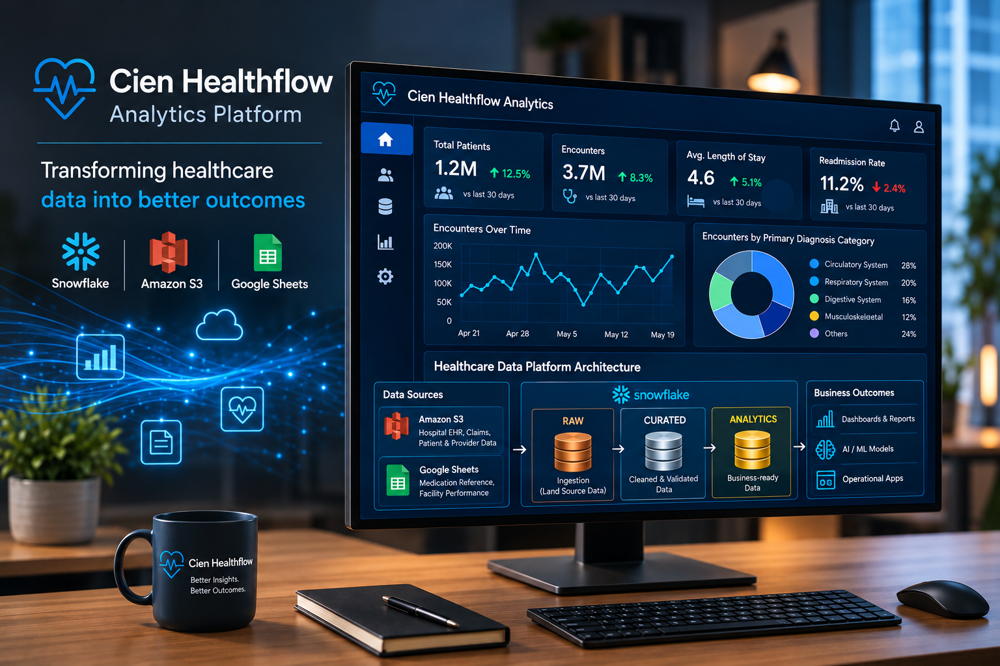

# Cien-Healthflow-Analytics

An end-to-end healthcare intelligence platform designed to unify fragmented patient, insurance claims, and operational data into a secure, reliable, and intelligent data ecosystem. The platform streamlines data processing, ensures data quality and governance, automates workflows, and transforms complex healthcare information into actionable insights. It also aims to integrate an AI-powered medical knowledge assistant to deliver context-aware, evidence-grounded responses, supporting smarter decision-making, operational efficiency, and improved healthcare outcomes.



# Cien HealthFlow Analytics

An end-to-end healthcare intelligence platform designed to unify fragmented patient, insurance claims, and operational data into a secure, reliable, and intelligent data ecosystem. The platform streamlines data processing, ensures data quality and governance, automates workflows, and transforms complex healthcare information into actionable insights. It also aims to integrate an AI-powered medical knowledge assistant to deliver context-aware, evidence-grounded responses, supporting smarter decision-making, operational efficiency, and improved healthcare outcomes.

## 1. Business Problem

Healthcare organisations generate large volumes of patient records, insurance claims, diagnosis histories, and operational metrics across disconnected systems.

This fragmented data creates several challenges:

- **Data Silos:** Patient, claims, and facility information is stored across different platforms.
- **Data Inconsistency:** Multiple data sources make validation and standardisation difficult.
- **Manual Processing:** Repeated ingestion and transformation tasks reduce operational efficiency.
- **Limited Visibility:** Healthcare teams struggle to analyse claim costs, patient trends, and facility performance.
- **Security & Governance:** Sensitive healthcare information requires controlled access and reliable data management.

## 2. Project Objectives

Build a scalable healthcare data platform using Snowflake to:

- Centralise structured healthcare data from Amazon S3 and Google Sheets.
- Implement a **Medallion Architecture (RAW → CURATED → ANALYTICS)**.
- Develop reliable ingestion, validation, and transformation pipelines.
- Automate data processing using Snowflake Streams and Tasks.
- Apply data security, governance, and role-based access controls.
- Enable analytical reporting on patient demographics, claims, diagnoses, and facility performance.
- Extend the platform with an AI-powered medical knowledge assistant.

## 3. Technology Stack

| Technology                | Purpose                                       |
| ------------------------- | --------------------------------------------- |
| Snowflake                 | Cloud data platform and data warehousing      |
| SQL                       | Data ingestion, transformation, and analytics |
| Python                    | Data integration and ingestion automation     |
| Amazon S3                 | Cloud storage for healthcare CSV datasets     |
| Google Sheets             | Reference and operational metrics sources     |
| Snowflake Stages          | External and internal data ingestion          |
| Snowflake Streams & Tasks | Change data capture and workflow automation   |
| Snowflake RBAC            | Data security and access governance           |

## 4. Data Sources

The platform integrates six healthcare datasets from two source systems.

**Source 1: Amazon S3 — Healthcare Records**

| Dataset                   | Records | Description                                                    |
| ------------------------- | ------: | -------------------------------------------------------------- |
| `patients.csv`          |  20,000 | Patient demographics, insurance, and contact details           |
| `providers.csv`         |     500 | Healthcare providers, specialisations, and facility mappings   |
| `claims.csv`            |  50,000 | Insurance claims, billing, approvals, and denials              |
| `diagnoses_history.csv` |  30,000 | Patient diagnosis history, severity, and treatment information |

**Source 2: Google Sheets — Reference & Operational Data**

| Dataset                          | Records | Description                                                          |
| -------------------------------- | ------: | -------------------------------------------------------------------- |
| `medications_reference.csv`    |     200 | Medication catalogue, pricing, and classifications                   |
| `facility_monthly_metrics.csv` |     720 | Facility-level patient volume, satisfaction, revenue, and wait times |

**Total source records: 101,420**

## 5. Data Architecture

The platform follows a three-layer Medallion Architecture.

```text
           DATA SOURCES
                 |
      +----------+----------+
      |                     |
  Amazon S3            Google Sheets
  (4 CSV Files)         (2 Datasets)
      |                     |
      +----------+----------+
                 |
                 v
         SNOWFLAKE PLATFORM
                 |
          RAW (Bronze)
        Data Ingestion
                 |
                 v
        CURATED (Silver)
     Cleaning & Validation
                 |
                 v
       ANALYTICS (Gold)
     Data Models & Insights
                 |
                 v
      Business Intelligence
       & AI Integration
```

### Snowflake Database Structure

```text
HEALTHFLOW_DB
│
├── RAW
│   └── Source Data & Landing Tables
│
├── CURATED
│   └── Cleaned & Validated Data
│
├── ANALYTICS
│   └── Analytical Tables & Views
│
└── GOVERNANCE
    └── Security Policies & Access Controls
```

### Virtual Warehouse Configuration

| Warehouse    | Size   | Auto-Suspend | Purpose                 |
| ------------ | ------ | ------------ | ----------------------- |
| INGEST_WH    | SMALL  | 60 sec       | Source data ingestion   |
| TRANSFORM_WH | MEDIUM | 120 sec      | Data transformations    |
| ANALYTICS_WH | MEDIUM | 300 sec      | Analytics and reporting |
| DEV_WH       | XSMALL | 60 sec       | Development and testing |

## 6. Implementation Progress

### Phase 01 — Snowflake Environment Setup

**Objective:** Establish the Snowflake infrastructure and database environment.

Key activities:

- Configured the `HEALTHFLOW_DB` database.
- Established four schemas: `RAW`, `CURATED`, `ANALYTICS`, and `GOVERNANCE`.
- Set up dedicated virtual warehouses for ingestion, transformation, analytics, and development.
- Configured warehouse sizing and auto-suspend settings.
- Established the foundational Snowflake object hierarchy.

**Outcome:** Snowflake environment structured to support data ingestion, processing, analytics, and governance.

### Phase 02 — Amazon S3 Data Ingestion

**Objective:** Load structured healthcare datasets from Amazon S3 into Snowflake.

Key activities:

- Configured CSV file formats with appropriate parsing settings.
- Established an external Snowflake stage for Amazon S3.
- Created RAW tables for patients, providers, claims, and diagnosis history.
- Used Snowflake `COPY INTO` to perform bulk data ingestion.
- Incorporated load validation and source-to-target record-count checks.

**Outcome:** Four healthcare datasets ingested into Snowflake's RAW layer, establishing the foundation for downstream transformations.

### Phase 03 — Google Sheets Data Ingestion with Python

**Objective:** Integrate reference and facility-level operational datasets into Snowflake.

Key activities:

- Established a Python-based ingestion approach for Google Sheets data.
- Used `gspread` and `snowflake-connector-python` as the integration tools.
- Prepared the ingestion workflow for medication reference and facility monthly metrics datasets.
- Loaded both datasets into the Snowflake RAW layer.
- Included data-loading validation and error-handling requirements.

**Outcome:** Expanded the RAW layer to six source datasets, bringing patient, claims, provider, diagnosis, medication, and facility information into a centralised healthcare data platform.

### Phase 04 — Data Transformation (RAW → CURATED)

**Objective:** Transform raw healthcare data into clean, validated, and standardised datasets using Snowflake SQL.

**Key Activities:**

- Created Snowflake Streams on RAW tables to track data changes (CDC).
- Implemented `MERGE` operations to handle inserts, updates, and deletes.
- Applied data deduplication using `QUALIFY` and `ROW_NUMBER()`.
- Standardised data types, handled NULL values, and validated critical fields.
- Added derived attributes such as patient age, claim processing days, and high-value claim flags.
- Created a consolidated `claim_line_items` table by joining claims with diagnosis history.
- Performed data quality checks and record-count validation.

**Outcome:** Established a structured CURATED layer with cleaned, deduplicated, and standardised healthcare datasets, ready for automated processing and downstream analytics.


### Phase 05 — Task Scheduling & Automation

**Objective:** Automate incremental data processing from RAW to CURATED using Snowflake Streams and Tasks.

**Key Activities:**

- Created Snowflake Tasks to execute `MERGE` operations for incremental data processing.
- Integrated Streams with Tasks to capture and process data changes (CDC).
- Configured a Task DAG using `AFTER` dependencies to manage execution order.
- Scheduled the root task to run automatically every 10 minutes.
- Enabled tasks and monitored execution using Snowflake Task History.
- Validated the automation pipeline by testing new data inserts and updates.

**Outcome:** Established an automated, dependency-driven ELT pipeline that incrementally synchronises RAW and CURATED datasets, reducing manual processing and supporting continuous data updates.
